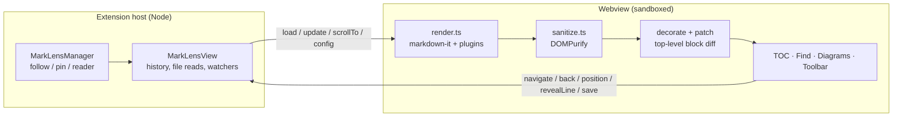

# MarkLens: design and plan

MarkLens is a Markdown *reader* for VS Code. Editing tools already exist. MarkLens is built to make long technical documents easy to read, explore and move around in.

The raw research notes are in [research.md](research.md).

## 1. What existing extensions do

| | Markdown Preview Enhanced 0.8.41 | Built-in preview | MarkLens |
| --- | --- | --- | --- |
| Diagram zoom | Zooms the whole preview (`body.style.zoom`). Open issues #568, #2005, #2256 | None (Mermaid needs another extension) | Each diagram has its own zoom and pan, a full-panel view and export |
| Links to local `.md` | Opens the **source editor**, except in "Previews Only" mode (issue #482) | `openMarkdownLinks: inPreview` replaces the preview | Opens in the reader with Back/Forward and scroll restore. The source editor is untouched |
| History | None | None | Browser-style, saved across reloads |
| Sidebar TOC | Collapsible and resizable, but no scroll-spy | None (VS Code's Outline view covers the editor only) | Collapsible, resizable, scroll-spy, search hit counts, drawer in narrow panels |
| Standalone reading | Custom editor | Custom editor, plus a lock | Reader custom editor; pinned previews |
| Find | Native find widget (`enableFindWidget`). Issue #2170 reports ⌘F not working | None | In-page find with CSS highlights and per-section counts |
| Rendering | In the extension host (crossnote), HTML pushed to a React webview | Extension host | In the webview. The extension host only reads files |

MPE's strength is breadth: code chunks, presentations, exports through Puppeteer or Pandoc, wiki links. MarkLens doesn't try to match that. It is focused on reading.

## 2. Architecture

- **The extension host owns documents and history.** `MarkLensView` reads files with `workspace.fs` or from an open `TextDocument`, so unsaved text shows too. It resolves links (`src/shared/links.ts`), keeps a `NavigationHistory` (`src/shared/history.ts`) and watches the shown file. Opening another document never touches the text editors. That is what makes in-reader navigation possible.
- **The webview owns rendering.** markdown-it with GitHub slugs, `data-line` attributes for scroll sync, task lists, callouts, footnotes, KaTeX and front matter; highlight.js. The HTML is sanitized with DOMPurify, then decorated: image paths, table wrappers, code headers, heading links.
- **Incremental updates.** Each update re-renders the Markdown but swaps only the top-level blocks whose HTML changed (ignoring line numbers). Kept blocks get their `data-line` values shifted. Diagrams keep their zoom while you type, and a 100 KB document updates without a flash.
- **Mermaid is loaded lazily** (`import('mermaid')`, about 5 MB of chunks spread across diagram types). It only loads when a document has a diagram. Diagrams render one at a time, visible ones first, and are cached by source and theme.
- **Two surfaces, one view class.** The side preview is a `WebviewPanel` with a serializer, so it survives restarts. The reader is a `CustomTextEditorProvider` with `priority: option`. Both use `retainContextWhenHidden`: rendered diagrams, zoom levels and scroll positions are worth the memory for a reader.
- **Security.** Strict CSP (nonce script, no `unsafe-eval`, scripts and styles only from the extension), DOMPurify (no scripts, forms, frames, `style` URLs), Mermaid `securityLevel: strict`, `enableCommandUris: false`, and `command:` / `vscode:` / `javascript:` links ignored.

## 3. Decisions that differ from the brief

- **No browser fullscreen.** Webview iframes don't grant the Fullscreen API. *Expand* fills the whole panel instead. To go bigger, maximize the editor group (double-click the tab).
- **A plain wheel never zooms an inline diagram.** It scrolls the page, as readers expect. ⌘/Ctrl+wheel and trackpad pinch zoom. In the full-panel view the wheel pans, like a map.
- **Inline diagrams fit the column width by default**, so nothing is clipped. Detail is one click away (Expand), and the viewport's height can be dragged.
- **Custom find instead of VS Code's find widget.** It shows hits per section in the table of contents and opens collapsed `
` that contain a match. The cost is that it doesn't support regex yet.
- **History lives in the extension host, not the webview**, so commands and keybindings (Back/Forward) work even when the webview doesn't have focus, and history is saved with the panel.
- **The unpinned preview follows the active editor, and those switches are added to history.** Back undoes an accidental switch.
- **Reading preferences are global settings.** The *Aa* pop-over changes `fontSize` and `contentWidth` in user settings, so every preview agrees.

## 4. Implementation plan and status

| # | Milestone | Status |
| --- | --- | --- |
| 1 | Scaffold: esbuild (Node CJS and browser ESM with code splitting), TypeScript, codicons | Done |
| 2 | Renderer: GFM, heading ids, line map, task lists, callouts, KaTeX, footnotes, front matter, highlighting | Done (unit tested) |
| 3 | Shell: toolbar with Back/Forward, breadcrumb of the current section, Find, *Aa*, TOC toggle | Done |
| 4 | Navigation: link classification, history, scroll restore, folder READMEs, `#L` source links, ⌘-click opens a pinned preview | Done (unit and integration tested) |
| 5 | TOC: tree, collapse, resize, scroll-spy, narrow drawer, search counts | Done |
| 6 | Diagrams: lazy Mermaid, cache, pan/zoom, full panel, SVG/PNG export, copy as image, error box | Done |
| 7 | Live update with block diffing; scroll sync both ways | Done (integration tested) |
| 8 | Reader custom editor; pinning; serializer | Done (integration tested) |
| 9 | Packaging: icon, README, CHANGELOG, LICENSE, `.vscodeignore`, `vsce package` | Done (2.1 MB VSIX) |

### Next

- **Before publishing:** set `publisher` and `repository` in `package.json`, add screenshots or a GIF to the README, and run `vsce publish`. Consider also publishing to Open VSX.
- Hover previews for footnotes and cross-document links (show the target section in a tooltip).
- Broken-link detection: underline links whose target file or heading doesn't exist.
- Regex and whole-word options in find; find across the workspace's Markdown files.
- Image and table "expand" using the same full-panel viewer (images already have it).
- A web extension build for vscode.dev (the host code only uses `workspace.fs` and could be bundled for the browser).
- Wiki links (`[[page]]`) and a backlinks panel for note collections.
- Virtualized rendering for documents over about 2 MB.

## 5. Testing

- `npm test` runs unit tests for link classification, history and the renderer.
- `npm run test:vscode` runs integration tests in a real VS Code with an isolated profile. It opens the preview, navigates, follows the editor, picks up unsaved edits and opens the reader. It checks what the webview reports it rendered, including Mermaid success and failure counts.
- `npm run dev` starts a browser harness with a fake extension host (`dev/harness.ts`), used for UI work against `test-docs/`: an architecture doc with large Mermaid diagrams, a security report with wide tables and callouts, cross-linked references, and a generated 480-section document.
