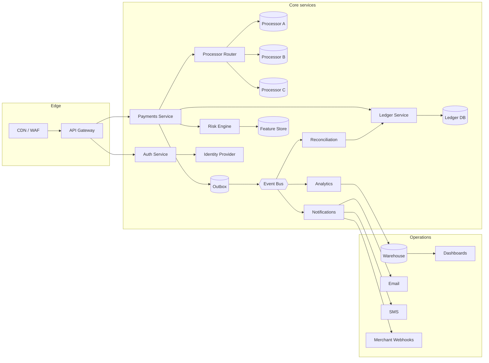
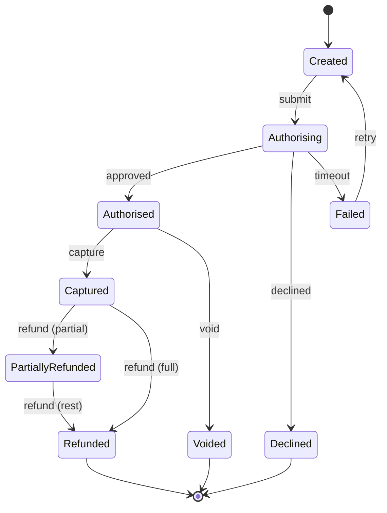
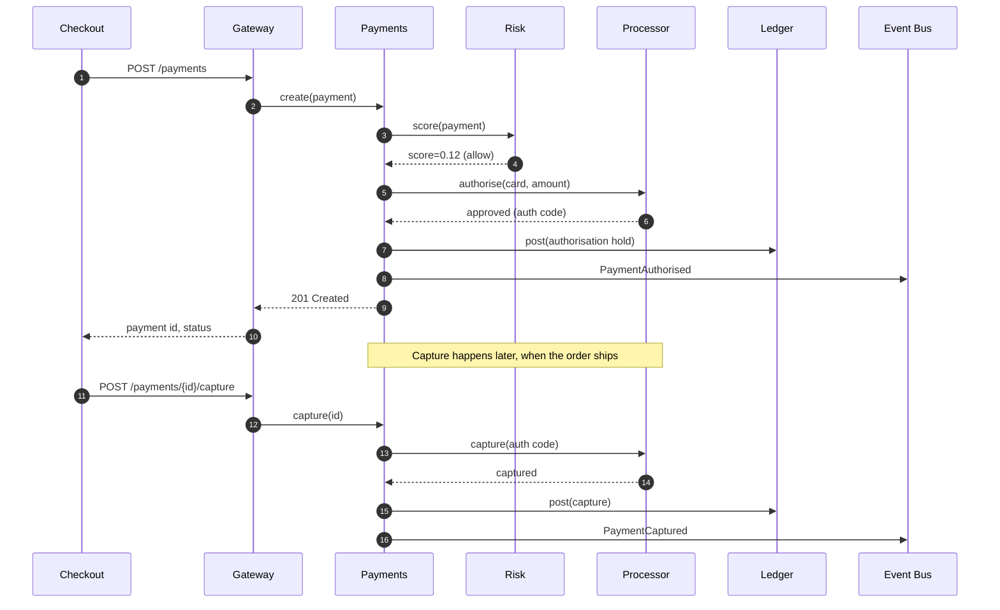
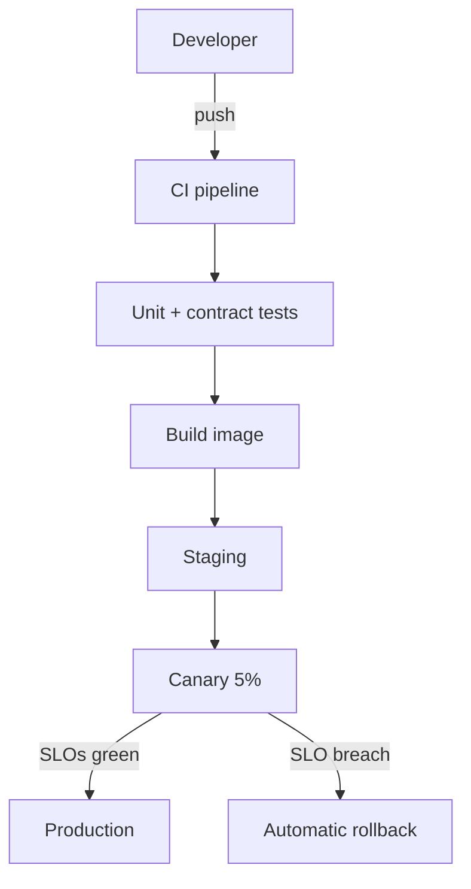
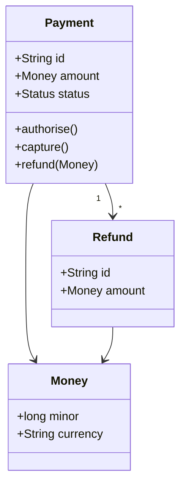

# Payments Platform Architecture

Back to the [index](index.md). See also the [security assessment](security-report.md#findings).

## Overview

The platform accepts card and bank payments through a gateway, authorises them with external processors, and records every movement in a double-entry ledger.



## Services

### API Gateway

Terminates TLS, enforces rate limits and routes requests. Configuration lives in `gateway/routes.yaml`.

### Payments Service

Owns the payment state machine.



### Ledger Service

Every movement is two entries that sum to zero.

```ts
export interface Entry {
  account: AccountId;
  amount: Money; // positive = debit, negative = credit
  journalId: string;
}

export function post(journal: Entry[]): void {
  const sum = journal.reduce((s, e) => s + e.amount.minor, 0);
  if (sum !== 0) throw new Error(`Unbalanced journal: ${sum}`);
  db.insertMany(journal);
}
```

## Data flow

A card payment from checkout to settlement:



## Deployment



### Environments

| Environment | Region | Replicas | Database | Notes |
| --- | --- | ---: | --- | --- |
| dev | eu-west-1 | 1 | shared Postgres | Reset nightly |
| staging | eu-west-1 | 2 | Postgres 16 | Production-like data volumes |
| production | eu-west-1, eu-central-1 | 6 | Postgres 16 (multi-AZ) | Active-active |

## Class model



## A broken diagram

The next block has a syntax error on purpose:

```mermaid
flowchart LR
  A --> B -->
```

## Open questions

1. Should reconciliation run per processor or globally?
2. Do we need a separate store for disputes?
