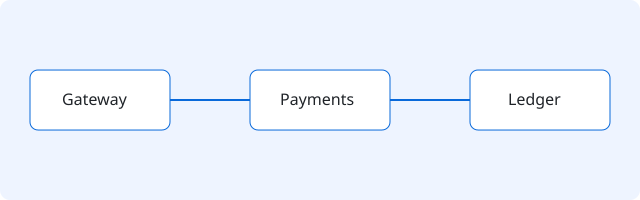

# Payments Platform

This folder is a realistic set of technical documents used to test **MarkLens**. Follow the links to move between documents without leaving the preview.

> [!NOTE]
> Links to other Markdown files open *inside the reader*. Use **Back** (⌘[ / Alt+←) to return, and your scroll position is restored.

## Documents

| Document | What it covers | Status |
| --- | --- | --- |
| [Architecture](architecture.md) | Services, data flow, deployment | Reviewed |
| [Security assessment](security-report.md) | Findings, risk ratings, remediation | Draft |
| [API reference](reference/api.md) | Endpoints and error codes | Stable |
| [Incident 2026-10-14](reference/incident-2026-10-14.md#timeline) | Investigation and timeline | Closed |
| [Large document](large.md) | Performance test, 400+ sections | Generated |

## Quick links

- Jump to a section in another document: [Data flow](architecture.md#data-flow)
- Same-document anchor: [Conventions](#conventions)
- A folder link opens its README: [reference/](reference/)
- A source file opens in the editor: [extension.ts](../src/extension/extension.ts#L10)
- A broken link shows a clear message: [missing.md](missing.md)
- External link: [Mermaid docs](https://mermaid.js.org)

## Conventions

- [x] Every design doc has a diagram
- [x] Every finding has an owner
- [ ] Every API has an example
  - [ ] Nested task item

Inline math like $E = mc^2$ and a block:

$$
\text{availability} = \frac{\text{MTBF}}{\text{MTBF} + \text{MTTR}}
$$

A footnote reference.[^1]

[^1]: Footnotes render at the end of the document and link back.
