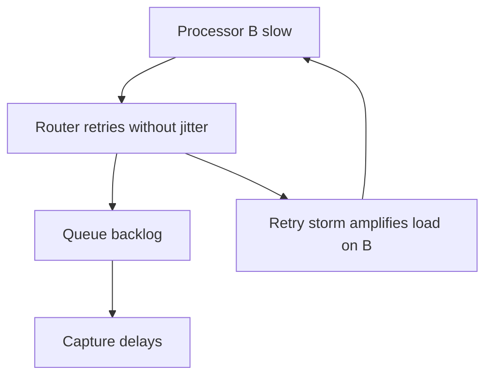

# Incident 2026-10-14: Capture delays

Related: [Architecture › Payments Service](../architecture.md#payments-service)

## Summary

Captures were delayed by up to 40 minutes for Processor B.

## Timeline

| Time (UTC) | Event |
| --- | --- |
| 09:12 | Capture latency alert fires |
| 09:20 | On-call confirms backlog in the router queue |
| 09:41 | Processor B reports degraded API |
| 10:05 | Traffic shifted to Processor C |
| 10:52 | Backlog cleared |

## Root cause

## Actions

- [x] Add jitter to router retries
- [ ] Circuit breaker per processor
- [ ] Alert on queue age, not only size
