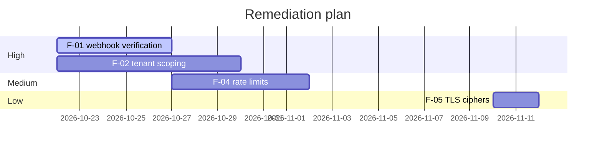

# Security Assessment — Payments Platform

| Field | Value |
| --- | --- |
| Scope | Gateway, Payments, Ledger |
| Period | 2026-10-01 to 2026-10-21 |
| Method | Design review, code review, dynamic testing |

> Draft for review. Findings may change after the retest on 2026-11-02; see `retest-plan.md` for the schedule.

[Architecture](architecture.md) · [API reference](reference/api.md)

## Summary

> [!IMPORTANT]
> Two high-risk findings must be fixed before the production launch.

> [!TIP] How to read this report
> Each finding has a rating, the affected component and a recommended fix. Ratings follow the matrix in [Risk ratings](#risk-ratings).

## Findings

| ID | Title | Component | Likelihood | Impact | Rating | Owner | Status | Recommendation summary | Ticket |
| --- | --- | --- | --- | --- | --- | --- | --- | --- | --- |
| F-01 | Webhook signatures not verified on retry path | Notifications | Medium | High | **High** | notifications-team | Open | Verify the HMAC on every delivery attempt, including retries from the dead-letter queue | PAY-1201 |
| F-02 | Ledger admin endpoint lacks per-tenant scoping | Ledger | Low | High | **High** | ledger-team | In progress | Scope queries by tenant id taken from the token, never from the request body | PAY-1188 |
| F-03 | Verbose errors include stack traces | Gateway | High | Low | Medium | edge-team | Fixed | Map internal errors to stable codes; log details server-side only | PAY-1175 |
| F-04 | Rate limits keyed by IP only | Gateway | Medium | Medium | Medium | edge-team | Open | Key limits by API client and IP; add burst limits for auth endpoints | PAY-1210 |
| F-05 | Outdated TLS ciphers on internal LB | Platform | Low | Medium | Low | platform-team | Accepted | Restrict to TLS 1.2+ AEAD suites at the next maintenance window | PAY-1214 |

### F-01 Webhook signatures not verified on retry path

> [!WARNING]
> Retries read the payload from the dead-letter queue and skip verification.

```diff
 def deliver(event, attempt):
-    if attempt == 0:
-        verify_signature(event)
+    verify_signature(event)
     send(event)
```

### F-02 Ledger admin endpoint lacks per-tenant scoping

The handler builds the query from a request field:

```go
func (h *Handler) Entries(w http.ResponseWriter, r *http.Request) {
	tenant := r.URL.Query().Get("tenant") // should come from the token
	rows, err := h.db.Query(ctx, "select * from entries where tenant_id = $1", tenant)
	if err != nil {
		http.Error(w, "internal error", 500)
		return
	}
	writeJSON(w, rows)
}
```

> [!CAUTION]
> Changing the tenant parameter returns another tenant's entries.

### F-03 Verbose errors

Fixed in release 2.14.0. Verified by retest on 2026-10-19.

## Risk ratings

| Likelihood \ Impact | Low | Medium | High |
| --- | --- | --- | --- |
| **High** | Medium | High | Critical |
| **Medium** | Low | Medium | High |
| **Low** | Low | Low | Medium |

## Remediation plan



<details>
<summary>Test accounts used</summary>

| Account | Role |
| --- | --- |
| `merchant-a` | Merchant (tenant A) |
| `merchant-b` | Merchant (tenant B) |
| `ops-reader` | Read-only operator |

</details>

## Appendix: tools

- `nuclei` for template scans
- `semgrep` with the `p/golang` rules
- Manual review of every handler under `ledger/admin/`
